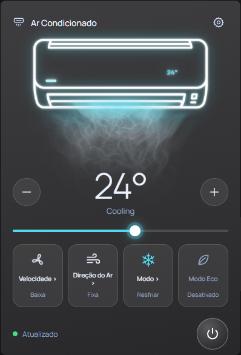

# Painel de Ar-Condicionado Midea

Aplicativo para controlar localmente um ar-condicionado Midea em uma janela do Windows. O painel permite ligar e desligar o aparelho, ajustar a temperatura, o modo de operação, a velocidade do ventilador e a oscilação das aletas, além de acessar funções como Eco e display quando suportadas pelo modelo.

## Requisitos

- Windows 10 ou 11.
- Um ar-condicionado Midea compatível com a biblioteca `msmart-ng` (protocolos/tipos reconhecidos pelo projeto).
- O computador e o ar-condicionado conectados à mesma rede local, normalmente ao mesmo Wi-Fi.
- O aplicativo oficial MSmartHome instalado e configurado: faça login nele e conecte o ar-condicionado à rede Wi-Fi antes de usar este painel.
- Para executar a partir do código-fonte, Python 3.12 ou compatível com as dependências listadas em `requirements.txt`.

## Instalação e primeira configuração

1. Instale o MSmartHome no celular, entre na sua conta Midea e conclua a configuração do ar-condicionado no Wi-Fi.
2. Baixe ou clone este projeto no computador Windows.
3. Inicie o painel:
   - **Versão empacotada:** abra `dist/Painel AC.exe`.
   - **Código-fonte:** abra `Painel AC.bat`. Na primeira execução, ele cria o ambiente Python local e instala as dependências; é necessário ter Python instalado e conexão com a internet nessa etapa.
4. No painel, abra **Conectar aparelho**, informe a mesma conta e senha usadas no MSmartHome e selecione a região da conta. Use **Buscar aparelhos** e escolha o ar-condicionado encontrado.
5. Após autenticar e selecionar o aparelho, o painel salva os dados de autenticação local e a configuração escolhida. Nas próximas execuções, o controle pode se conectar diretamente pela rede local.

A senha da conta é usada para autenticar a sessão de configuração e não é gravada pelo painel. A região precisa corresponder à conta MSmartHome; as opções disponíveis são Global/Estados Unidos, Europa e Coreia do Sul.

## Como funciona

O painel combina uma etapa inicial de autenticação na nuvem Midea com o controle local do aparelho:

1. **Login e descoberta:** durante a configuração, o painel usa a biblioteca `msmart-ng` para validar a conta MSmartHome e localizar aparelhos Midea na rede. A busca tenta descoberta UDP por broadcast; se não encontrar um ar-condicionado, o aplicativo faz uma varredura local complementar.
2. **Token e chave:** para aparelhos que exigem autenticação local, a biblioteca solicita à nuvem Midea um par `token`/`key` associado ao dispositivo e autentica a conexão. O painel guarda esse par em `devices.json`, junto com informações como identificador, IP, protocolo e modelo. Esse arquivo é criado ao lado do executável ou do código.
3. **Controle pela rede local:** depois da configuração, o painel recupera o token e a chave, autentica o dispositivo e envia os comandos diretamente ao ar-condicionado. O tráfego de controle usa o protocolo MSmart sobre UDP, normalmente na porta 6444. A descoberta usa broadcast UDP na porta 6445; a busca complementar também consulta a porta 20086. O uso dessas portas depende da implementação do protocolo e da biblioteca `msmart-ng`.
4. **Confirmação do estado:** após enviar um comando, o painel consulta novamente o aparelho para atualizar a interface e confirmar o estado. Como o dispositivo pode ignorar um primeiro pacote, o aplicativo tenta reenviar o comando até observar o valor solicitado ou atingir o limite de tentativas.

Assim, a conta Midea é necessária para a configuração/autorização inicial e para obter as credenciais locais. O controle cotidiano é feito na rede local, sem enviar cada comando à nuvem. Por isso, o computador precisa alcançar o ar-condicionado pela rede; isolamento entre clientes Wi-Fi, firewall ou redes diferentes podem impedir a descoberta ou o controle.

## Dados locais e segurança

- `devices.json` contém o token e a chave que permitem controlar o aparelho. **Não compartilhe nem publique esse arquivo.** Ele é excluído do Git pelo `.gitignore`.
- `tray_config.json` guarda o IP e a região selecionados; também é excluído do Git.
- `web_panel.log` registra informações de execução e é excluído do Git.
- A senha digitada no painel é usada para autenticação e não é salva pelo aplicativo.
- O executável em `dist/Painel AC.exe` pode ser versionado. Os JSONs e logs gerados dentro de `dist/` permanecem ignorados.

## Dependências

As dependências do código-fonte estão em [`requirements.txt`](requirements.txt). O painel usa `msmart-ng` para comunicação e protocolo Midea, `pywebview` para a janela, `Pillow` e `pystray` para a bandeja do sistema, e `psutil` para a busca complementar na rede local.

## Solução de problemas

- **Nenhum aparelho encontrado:** confirme que o ar-condicionado está ligado à rede Wi-Fi no MSmartHome, que o computador está na mesma rede e que o roteador não bloqueia comunicação entre dispositivos.
- **Login ou autenticação falhou:** confira a conta que é proprietária do aparelho, a senha e a região selecionada no MSmartHome.
- **O aparelho foi encontrado, mas não responde:** verifique se o IP ainda é o mesmo e se o firewall do Windows permite comunicação local. Se necessário, abra novamente **Conectar aparelho** e refaça a busca.
- **A busca complementar não funciona no código-fonte:** confira se as dependências foram instaladas corretamente; essa busca usa `psutil`.

## Créditos e protocolo

O projeto usa [`msmart-ng`](https://pypi.org/project/msmart-ng/), uma biblioteca comunitária que implementa a comunicação com aparelhos compatíveis com o ecossistema Midea/SmartHome. Este painel não é um aplicativo oficial da Midea.
